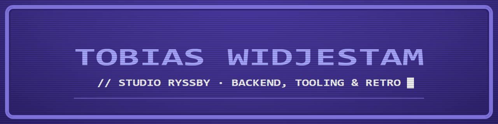

  

## Hi, I'm Tobias

Java fullstack student at Lexicon. I build small, sharp tools
and take things apart until I understand how they work — course exercises, a Java
weather app, and a fair amount of computing on the side.

The C64 look is the house style, not the job description. ☕

---

### Java & fullstack

| Project | What it is |
|---|---|
| [Lexicon-workshops](https://github.com/tobiaswidjestam-design/Lexicon-workshops) | Flowcharts, pseudocode and Java exercises |
| [Lexicon-Tobias-Widjestam](https://github.com/tobiaswidjestam-design/Lexicon-Tobias-Widjestam) | Course documentation: the Java toolchain I set up |

### Other projects

| Project | What it is |
|---|---|
| [RyssbyVader](https://github.com/tobiaswidjestam-design/RyssbyVader) | A personal weather app for Ryssby — Java Swing desktop and an Android build, made as a side project with AI assistance |
| [c64-launchbox-launcher](https://github.com/tobiaswidjestam-design/c64-launchbox-launcher) | A small C# launcher that lets LaunchBox start Commodore 64 games in VICE when each game is a zip with several files |
| IngelaAndSofieTheGame | A small 2D game in C++ — hand-drawn characters, sprite sheets, animation and sound *(private while in development)* |
| AphexMediaPlayer | A modern media player written in C++ |

### Working with

### Currently learning

### How I work

- **Small steps, verified** — build it, run it, watch the log, then trust it.
- **Nothing destructive** — back up the config before touching it, and every change should be reversible.
- **Readable over clever** — a tool someone else can follow is a tool that survives.

---

  Studio Ryssby · <code>READY.</code>

